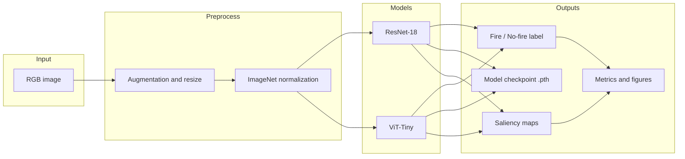
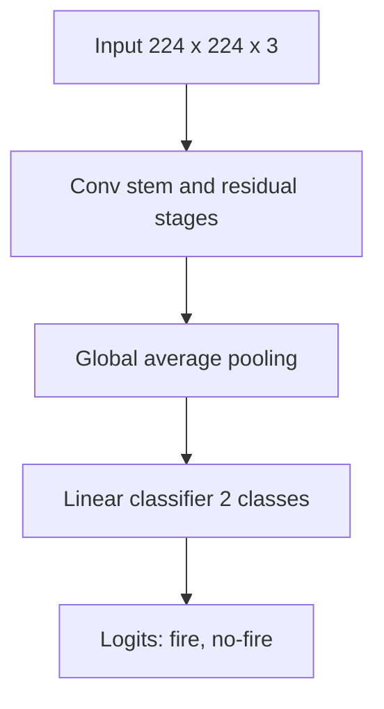
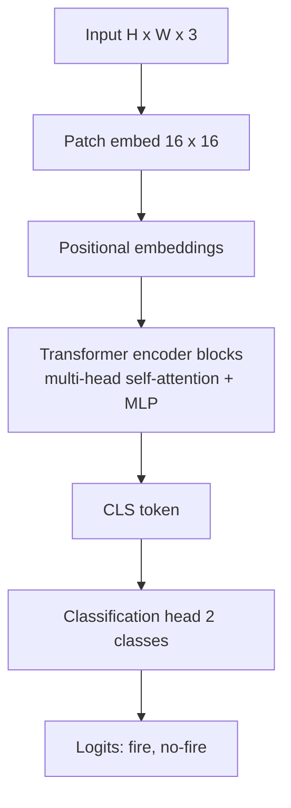

# Forest Fire Detection: Comparative Study of ResNet-18 and Vision Transformers

Automated binary classification of wildfire imagery (**fire** vs. **no-fire**) using transfer learning on pretrained deep networks. The project benchmarks a **ResNet-18** convolutional baseline against **ViT-Tiny** (`vit_tiny_patch16_224`) variants, evaluates **out-of-distribution (OOD) generalization** on ground-level fire imagery, quantifies **spatial explainability** via the **Fire Attention Faithfulness Score (FAFS)**, and profiles **computational cost** for CPU deployment.

The implementation is delivered as a single end-to-end Jupyter notebook pipeline. Detailed metric tables and interpretability studies are also recorded under `forest_fire_detection/docs/`.

---


## Table of Contents

1. [Problem Statement and Scope](#problem-statement-and-scope)
2. [Repository Layout](#repository-layout)
3. [System Architecture](#system-architecture)
4. [Models and Training Protocols](#models-and-training-protocols)
5. [Datasets and Evaluation Protocol](#datasets-and-evaluation-protocol)
6. [Results Summary](#results-summary)
7. [Model Comparison](#model-comparison)
8. [Explainability (FAFS)](#explainability-fafs)
9. [Computational Profiling](#computational-profiling)
10. [Reproducibility and Artifacts](#reproducibility-and-artifacts)
11. [References and Attribution](#references-and-attribution)

---


## Problem Statement and Scope

**Objective.** Given a single RGB image from forest or wildfire monitoring contexts, predict whether the scene contains active fire or smoke indicative of fire.

**Task formulation.** Image-level binary classification (not object detection or segmentation at inference time). Optional pixel-level masks are used only to **evaluate** explanation maps after training.

**Deliverables produced by the pipeline.**


| Deliverable             | Description                                                                |
| ----------------------- | -------------------------------------------------------------------------- |
| Trained checkpoints     | `vit_forest_fire.pth`, `resnet18_fire.pth`, `vit_forest_fire_improved.pth` |
| Classification metrics  | Precision, recall, F1, and accuracy on validation, test, and OOD splits    |
| Explainability analysis | Attention Rollout (ViT), Grad-CAM (ResNet), FAFS vs. manual masks          |
| Publication figures     | Confusion matrices and saliency overlays (PNG/PDF, 300 DPI)                |


**Out of scope in this repository.** Real-time video ingestion, REST or mobile deployment, and trained weights are generated locally when the notebook is executed; they are not versioned as release artifacts unless you add them.

---


## Repository Layout

```
Forest-Fire-Detection/
├── README.md
├── .gitignore
├── forest_fire_detection/
│   ├── notebooks/
│   │   ├── fire_detection.ipynb                  # Canonical pipeline (use this notebook)
│   │   └── fire_detection_DO_NOT_USE.ipynb       # Legacy duplicate; outdated outputs
│   ├── docs/                                     # Recorded evaluation and ablation reports
│   │   ├── analysis_results.md
│   │   ├── zeroshot_generalization_report.md
│   │   ├── explainability_comparative_report.md
│   │   ├── fafs_threshold_ablation.md
│   │   └── fafs_robust_comparison.md
│   ├── datasets/
│   │   └── fire_dataset.zip              # In-repository dataset archive (see below)
│   └── results/                                  # Example attention overlays (optional)
```

The notebook reads an **ImageFolder** layout at `./data` (extracted locally, not committed): `data/train`, `data/val`, and `data/test` with class subfolders `fire` and `nofire`, plus optional `data/mask` for explainability evaluation.

---


## System Architecture


### End-to-end pipeline




### ResNet-18 baseline (convolutional)




ResNet-18 uses **local receptive fields** and **translation-equivariant** convolutions. ImageNet-pretrained weights are fine-tuned on wildfire data (full-network training, 10 epochs in the reported run).

### ViT-Tiny (`vit_tiny_patch16_224`)




**Baseline ViT configuration.** Training at **128 x 128** with a frozen backbone and short linear probe (3 epochs). Positional embeddings designed for **224 x 224** are interpolated to an 8 x 8 patch grid, which introduces a resolution mismatch when inference uses 224 x 224.

**Improved ViT configuration.** Training and evaluation fixed at **224 x 224** (14 x 14 = 196 patch tokens, matching pretrained layout). **Two-stage fine-tuning:** Stage 1 freezes the transformer backbone and trains only the head (10 epochs); Stage 2 unfreezes the full model with a reduced learning rate (5 epochs).

---


## Models and Training Protocols


| Configuration      | Architecture           | Input resolution | Training strategy                      | Checkpoint                     |
| ------------------ | ---------------------- | ---------------- | -------------------------------------- | ------------------------------ |
| Baseline ViT       | `vit_tiny_patch16_224` | 128 x 128        | Frozen backbone, 3-epoch head training | `vit_forest_fire.pth`          |
| ResNet-18 baseline | `resnet18` (ImageNet)  | 224 x 224        | Full fine-tuning, 10 epochs            | `resnet18_fire.pth`            |
| Improved ViT       | `vit_tiny_patch16_224` | 224 x 224        | Two-stage: 10 + 5 epochs               | `vit_forest_fire_improved.pth` |


**Shared preprocessing (Improved ViT and ResNet).** Resize to 224 x 224; training augmentations include random horizontal flip, rotation (up to 15 degrees for Improved ViT), and color jitter; normalization with ImageNet mean and standard deviation.

**Optimization (Improved ViT).** Stage 1 uses a higher learning rate on the classification head only; Stage 2 uses a small learning rate on the full model to adapt self-attention layers without destroying pretrained representations.

---


## Datasets and Evaluation Protocol


### In-distribution (ID):

Primary wildfire imagery: aerial and forest views with flames, smoke, and varied illumination. The evaluation split used in documentation:


| Split      | Images    | Fire  | No-fire |
| ---------- | --------- | ----- | ------- |
| Train      | 2,062     | 1,170 | 892     |
| Validation | 441       | 250   | 191     |
| Test       | 444       | 252   | 192     |
| **Total**  | **2,947** |       |         |


**Explainability subset.** Manual binary masks on a small set of validation fire images (`data/mask`), plus extended FAFS evaluation over **50** annotated masks (see docs).

**Distribution in this repository.** The ID corpus is shipped as a single archive:


| Artifact    | Location                                          |
| ----------- | ------------------------------------------------- |
| Dataset ZIP | `forest_fire_detection/datasets/fire_dataset.zip` |


The archive contains the ImageFolder splits used for training and evaluation (`train`, `val`, `test`, and masks where applicable). Extract it before running the notebook (see [Reproducibility and Artifacts](#reproducibility-and-artifacts)).

**Original source and license.** Derived from the Karabuk University *master_proje* release on [Roboflow Universe](https://universe.roboflow.com/karabuk-un/master_proje/dataset/1) (CC BY 4.0). The ZIP in this repository is a packaged copy of that material for reproducibility without a separate download step.

### Out-of-distribution (OOD): FireNet (zero-shot)

Models trained only on ID forest imagery are evaluated **without retraining** on:


| OOD split                            | Count   |
| ------------------------------------ | ------- |
| Fire (ground-level, urban, domestic) | 90      |
| No-fire backgrounds                  | 191     |
| **Total**                            | **281** |


This measures whether models learn combustion-related cues rather than forest-specific background texture.

---


## Results Summary


### In-distribution classification


| Model        | Eval split | Accuracy   | Fire precision | Fire recall | No-fire precision | No-fire recall |
| ------------ | ---------- | ---------- | -------------- | ----------- | ----------------- | -------------- |
| Baseline ViT | Test       | **94.82%** | 0.93           | 0.98        | 0.98              | 0.90           |
| ResNet-18    | Validation | **98.41%** | 0.98           | 0.99        | 0.99              | 0.98           |
| Improved ViT | Validation | **99.32%** | 0.99           | 1.00        | 0.99              | 0.99           |
| Improved ViT | Test       | **99.32%** | 0.99           | 1.00        | 1.00              | 0.98           |


**Safety-relevant observation.** The Improved ViT achieves **100% fire recall** on the documented validation and test splits (no missed fire images in those evaluations). The Baseline ViT’s weaker no-fire recall (90% on test) reflects a higher false-alarm rate on non-fire scenes, linked in analysis to train/inference resolution mismatch.

### Out-of-distribution (zero-shot on FireNet + local no-fire)


| Model        | OOD accuracy | Fire precision | Fire recall | No-fire precision | No-fire recall |
| ------------ | ------------ | -------------- | ----------- | ----------------- | -------------- |
| ResNet-18    | **93.95%**   | 1.00           | **81.11%**  | 0.92              | 1.00           |
| Improved ViT | **98.22%**   | 0.97           | **97.78%**  | 0.99              | 0.98           |


**OOD confusion (fire class).** ResNet-18: 73 correct, 17 missed fires (of 90). Improved ViT: 88 correct, 2 missed fires.

---


## Model Comparison


### Classification: when each model leads


| Criterion             | ResNet-18                        | Baseline ViT                 | Improved ViT                       |
| --------------------- | -------------------------------- | ---------------------------- | ---------------------------------- |
| ID accuracy           | Strong (98.41% val)              | Moderate (94.82% test)       | **Best (99.32% val/test)**         |
| Fire recall (ID test) | High on val                      | High but more false fires    | **1.00 on documented test**        |
| OOD fire recall       | **81.11%**                       | Not primary focus            | **97.78%**                         |
| Parameters            | 11.18 M                          | ~5.7 M (baseline)            | **5.52 M**                         |
| Inductive bias        | Local textures, sharp boundaries | Global context via attention | Global context, resolution-aligned |


**Interpretation.** ResNet-18 converges quickly on in-distribution forest views but **degrades under domain shift** when scene layout and scale differ from training (trees, wide aerial context). The Improved ViT’s self-attention aggregates long-range evidence, which supports **generalization to ground-level fire** at higher sensitivity, with competitive ID accuracy and **lower model size**.

### Explainability vs. accuracy trade-off


| Method            | Model        | Peak mean FAFS (IoU) | Threshold at peak | Notes                                            |
| ----------------- | ------------ | -------------------- | ----------------- | ------------------------------------------------ |
| Grad-CAM          | ResNet-18    | **0.3189**           | t = 0.4           | Dense, localized activations on flame boundaries |
| Attention Rollout | Baseline ViT | **0.3475**           | t = 0.3           | Broader attention; coarser maps at 128 x 128     |
| Attention Rollout | Improved ViT | **0.3150**           | t = 0.3           | Sharper 224 x 224 peaks; slightly lower peak IoU |


At the commonly reported operating point **t = 0.6**, mean FAFS is approximately **0.29** (ResNet Grad-CAM), **0.185** (Baseline ViT), and **0.184** (Improved ViT) over N = 50 masks. CNN explanations tend to align more contiguously with tight manual polygons; ViT rollouts encode **wider contextual reasoning**, which aids classification under shift but can reduce strict mask overlap.

### Deployment-oriented efficiency (224 x 224, batch size 1, CPU)


| Metric     | ResNet-18         | Improved ViT         |
| ---------- | ----------------- | -------------------- |
| Parameters | 11.18 M           | **5.52 M**           |
| FLOPs      | 3.627 GFLOPs      | **2.150 GFLOPs**     |
| Latency    | 116.43 ± 16.73 ms | **69.45 ± 19.54 ms** |
| Throughput | 8.6 FPS           | **14.4 FPS**         |


Measurements: PyTorch 2.12 CPU build; 200 timed iterations after 50 warmup runs (`forest_fire_detection/docs/analysis_results.md`).

---


## Explainability (FAFS)

**Fire Attention Faithfulness Score (FAFS).** Intersection-over-union between a binarized explanation map and a manual fire/smoke mask. Maps are produced without pixel-level supervision during training.


| Component    | ViT                                                           | ResNet-18                               |
| ------------ | ------------------------------------------------------------- | --------------------------------------- |
| Explanation  | Attention Rollout (recursive attention product across layers) | Grad-CAM on deep convolutional features |
| Binarization | Threshold *t* on normalized saliency                          | Same                                    |
| Evaluation   | N = 50 validation masks; ablation over t in [0.1, 0.9]        | Same                                    |


Threshold ablation tables: `forest_fire_detection/docs/fafs_threshold_ablation.md` and `explainability_comparative_report.md`.

**Figures generated by the notebook (when executed).** Examples include `val_confusion_matrix`, `test_confusion_matrix`, `attention_comparison`, `attention_mask_overlay`, and `fafs_threshold_ablation` plots (PNG and PDF).

---


## Computational Profiling

Profiling compares **inference cost** only; training was performed on available hardware (GPU when present). Documented benchmarks emphasize **CPU latency** for edge-style deployment scenarios where GPU availability is limited.

---


## Reproducibility and Artifacts


### Environment

- Python 3.8+
- PyTorch, torchvision, `timm`, scikit-learn, matplotlib, Pillow, OpenCV

Install dependencies via the first cell of the notebook or:

```bash
pip install torch torchvision timm scikit-learn matplotlib Pillow opencv-python
```


### Dataset setup (ZIP)

From the **repository root**, extract the bundled archive so that `./data` exists with the expected layout:

**Linux or macOS**

```bash
unzip forest_fire_detection/datasets/fire_dataset.zip -d .
```

**Windows (PowerShell)**

```powershell
Expand-Archive -Path forest_fire_detection\datasets\fire_dataset.zip -DestinationPath .
```

If the ZIP root is a single `data/` folder, extracting to the repository root should yield `./data/train`, `./data/val`, and `./data/test`. If the archive contains only `train`, `val`, and `test` at its top level, extract into a new `data` directory instead:

```bash
mkdir -p data && unzip forest_fire_detection/datasets/fire_dataset.zip -d data
```

Confirm class folders (`fire`, `nofire` or `nofire` as named in the export) match `torchvision.datasets.ImageFolder` conventions before training.

### Execution

1. Complete [Dataset setup (ZIP)](#dataset-setup-zip) so `./data` is populated.
2. Open and run `forest_fire_detection/notebooks/fire_detection.ipynb` from the project root (paths are relative to `./data` and the working directory).
3. Checkpoints and figures are written to the notebook working directory.


### Supplementary reports


| Document                                                          | Content                                      |
| ----------------------------------------------------------------- | -------------------------------------------- |
| `forest_fire_detection/docs/analysis_results.md`                  | ID metrics, FAFS overview, complexity table  |
| `forest_fire_detection/docs/zeroshot_generalization_report.md`    | OOD zero-shot results                        |
| `forest_fire_detection/docs/explainability_comparative_report.md` | ResNet vs. ViT FAFS with standard deviations |
| `forest_fire_detection/docs/fafs_threshold_ablation.md`           | Threshold sensitivity                        |
| `forest_fire_detection/docs/fafs_robust_comparison.md`            | ViT baseline vs. improved FAFS at t = 0.6    |


---


## Repository hygiene

The following items are **candidates for removal or consolidation:**


| Item                                               | Recommendation                                                                                             |
| -------------------------------------------------- | ---------------------------------------------------------------------------------------------------------- |
| `fire_detection_DO_NOT_USE.ipynb`                  | **Deprecated duplicate** retained for reference only. Use `fire_detection.ipynb` in the same folder.       |
| Extracted `./data/`                                | Listed in `.gitignore`; use the committed ZIP under `forest_fire_detection/datasets/` and extract locally. |
| Generated `*.pth`, `venv/`, large notebook outputs | Do not commit; covered by `.gitignore`.                                                                    |


No automated training script (`train.py`) or mask utility (`jsontopng.py`) is present; the notebook is the sole implementation entry point.

---

## References and Attribution

**Architectures.** ResNet-18 (He et al., CVPR 2016); Vision Transformer (Dosovitskiy et al., ICLR 2021); Attention Rollout (Abnar and Zuidema, 2020); Grad-CAM (Selvaraju et al., ICCV 2017).

**License.** Project materials are described as CC BY 4.0 in project documentation; confirm license files before redistribution of weights or figures.

---

